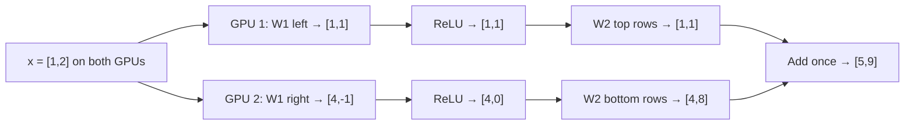

# 1.7 Splitting Matrices Across GPUs (Tensor Parallelism)

**When a model doesn't fit on one GPU, each weight matrix is cut into pieces, each GPU computes its piece, and the results are joined or added at the end.**

## Why this matters for inference

- Big models (70B and up) don't fit in one GPU's memory. Splitting them is the everyday solution.
- It also makes decode faster, because each GPU reads only its share of the weights.
- In vLLM this is one setting: `--tensor-parallel-size 4`. Knowing what it does lets you choose it well.
- Honest importance: high. This is real, daily inference work.

## Real-life example

### The wardrobe

You have 140 clothes, but one wardrobe holds only 80. They won't fit. Buy 2 wardrobes and put 70 in each.

### Report cards

A report card has 4 subjects. Two teachers share the work:

- Teacher 1 grades Maths and Science.
- Teacher 2 grades English and Hindi.

Both have the student's full answer sheet. At the end, the marks are placed side by side on one report card.

### Two kitchens

A dish has two stages: chop, then cook. If two kitchens keep sending half-done food back and forth, they waste time running. The smart way: each kitchen chops and cooks its own share, and the two portions are combined on one plate at the end. Only one hand-off.

## The math

### Step 1: The problem

```
70B model = 70 billion numbers × 2 bytes (BF16) = 140 GB
One H100 GPU = 80 GB
140 GB > 80 GB → doesn't fit

2 GPUs → 140 ÷ 2 = 70 GB per GPU → fits
```

Model size = parameters × bytes per number. (Simplified round numbers in this file: 80 GB per GPU and ~2,000 GB/s memory bandwidth. A real H100 SXM reads ~3.35 TB/s.)

### Setup for the examples

```
x = [1, 2]

W = | 1  0  2  1 |
    | 0  1  1  3 |
    (2 × 4)

Normal answer on 1 GPU:  x × W = [1, 2, 4, 7]
```

### Step 2: Split by columns (left | right)

```
     GPU 1          GPU 2
   | 1  0 |       | 2  1 |
   | 0  1 |       | 1  3 |
```

Both GPUs get the **full** x.

```
GPU 1: [1×1 + 2×0, 1×0 + 2×1] = [1, 2]
GPU 2: [1×2 + 2×1, 1×1 + 2×3] = [4, 7]

Join side by side: [1, 2, 4, 7]  ← same answer
```

This works because each output number comes from its own column. Columns don't need each other.

### Step 3: Split by rows (top / bottom)

```
GPU 1 gets row 1: [1, 0, 2, 1] and x's first number: 1
GPU 2 gets row 2: [0, 1, 1, 3] and x's second number: 2

GPU 1: 1 × [1, 0, 2, 1] = [1, 0, 2, 1]
GPU 2: 2 × [0, 1, 1, 3] = [0, 2, 2, 6]

Add:  [1, 0, 2, 1]
    + [0, 2, 2, 6]
    = [1, 2, 4, 7]  ← same answer
```

Each GPU makes a full-size but **partial** answer. Adding them gives the real answer. Adding across GPUs is called **all-reduce**. This works because matrix multiplication is linear: the sum of the parts equals the whole.

| Split | Each GPU gets | Combine by |
|---|---|---|
| Columns | Full x, some columns | Joining side by side |
| Rows | Part of x, some rows | Adding (all-reduce) |

### Step 4: The Megatron trick (feed-forward)

Feed-forward is `x → × W1 → ReLU → × W2`. Split **W1 by columns** and **W2 by rows**:

```
x = [1, 2]  (both GPUs)

W1 = | 1  -1 |  2   1 |       W2 = | 1  0 |  ← GPU 1
     | 0   1 |  1  -1 |            | 0  1 |  ← GPU 1
       GPU 1    GPU 2              | 1  2 |  ← GPU 2
                                   | 2  1 |  ← GPU 2
```

```
Stage 1, × W1 (columns):
  GPU 1: [1×1 + 2×0, 1×(-1) + 2×1] = [1, 1]
  GPU 2: [1×2 + 2×1, 1×1 + 2×(-1)] = [4, -1]

Stage 2, ReLU on each GPU (negative → 0):
  GPU 1: [1, 1]
  GPU 2: [4, 0]

Stage 3, × W2 (rows). Each GPU already holds exactly the input its rows need:
  GPU 1: [1, 1] × | 1 0 ; 0 1 | = [1, 1]
  GPU 2: [4, 0] × | 1 2 ; 2 1 | = [4×1 + 0×2, 4×2 + 0×1] = [4, 8]

Stage 4, add once (all-reduce):
  [1, 1] + [4, 8] = [5, 9]
```

Check on 1 GPU: `x × W1 = [1, 1, 4, -1]` → ReLU → `[1, 1, 4, 0]` → `× W2 = [5, 9]`. Same answer.



Why it works:

1. The column split leaves each GPU with exactly the slice that the row split needs as input.
2. ReLU works number by number, so no GPU needs the other's numbers.

| Approach | GPU conversations per block |
|---|---|
| Both matrices split by columns | 2 |
| Megatron (columns, then rows) | 1 |

Attention uses the same pattern: Wq, Wk, Wv split by columns (each GPU gets some heads), Wo split by rows, one all-reduce.

## Inference connection

### Speed

During decode, reading the weights is the slow part. With splitting, each GPU reads only its share:

| GPUs | Each GPU reads | Read time per token (ideal) | Fits in 80 GB? |
|---|---|---|---|
| 1 | 140 GB | — | No |
| 2 | 70 GB | 35 ms | Yes |
| 4 | 35 GB | 17.5 ms | Yes |
| 8 | 17.5 GB | 8.75 ms | Yes |

### Communication cost

- Every all-reduce takes some time. GPUs talk over a fast link called **NVLink**.
- A 70B model has 80 layers, each with attention and feed-forward, so about 160 all-reduces per token even with the Megatron trick.
- That is why 8 GPUs are not a full 8× faster.
- In practice you also need free memory for the KV cache, so a 70B BF16 model is often run on 4 GPUs, not 2.

### Another method (just know the name)

| Method | What is split | Example |
|---|---|---|
| Tensor Parallelism (TP) | Each weight matrix | Half of every layer on each GPU |
| Pipeline Parallelism (PP) | The layers | Layers 1–40 on GPU 1, 41–80 on GPU 2 |

TP is the most common choice inside one machine.

## Remember

- Model size = parameters × bytes. If it's bigger than GPU memory, split it.
- Split by columns → every GPU gets full x → join the outputs.
- Split by rows → each GPU gets part of x → add the outputs (all-reduce).
- Megatron trick: W1 by columns, ReLU locally, W2 by rows → only one all-reduce per block.
- More GPUs = less to read per GPU = faster, but each all-reduce costs time.

## Quick check

1. A 13B model in BF16. How many GB? Does it fit on one 24 GB GPU?
2. `x = [2, 1]`, W columns are `[1, 2]` and `[3, 0]` (W rows: `[1, 3]`, `[2, 0]`). Split by columns: what does each GPU produce, and what is the final answer?
3. When you split by rows, do you join or add the results?
4. Why does ReLU not need any GPU communication?

<details>
<summary>Answers</summary>

1. 13B × 2 = **26 GB**. **No**, 26 > 24. Use 2 GPUs or quantize to INT8 (13 GB).
2. GPU 1: 2×1 + 1×2 = **4**. GPU 2: 2×3 + 1×0 = **6**. Final: **[4, 6]**.
3. **Add** (all-reduce).
4. ReLU works on each number by itself, so each GPU only needs its own numbers.

</details>
